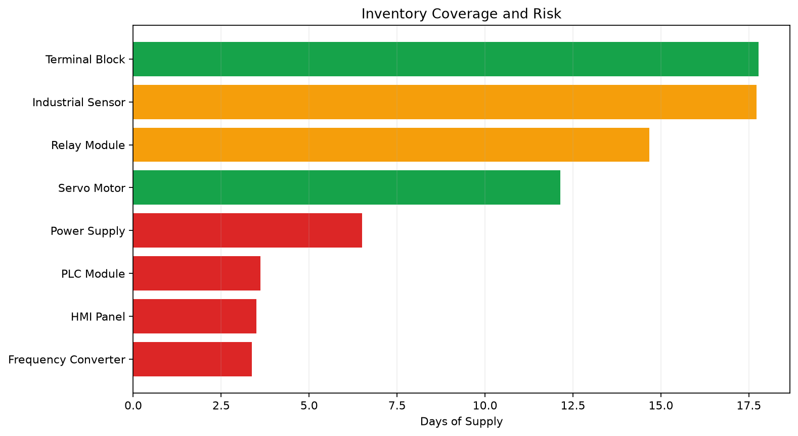
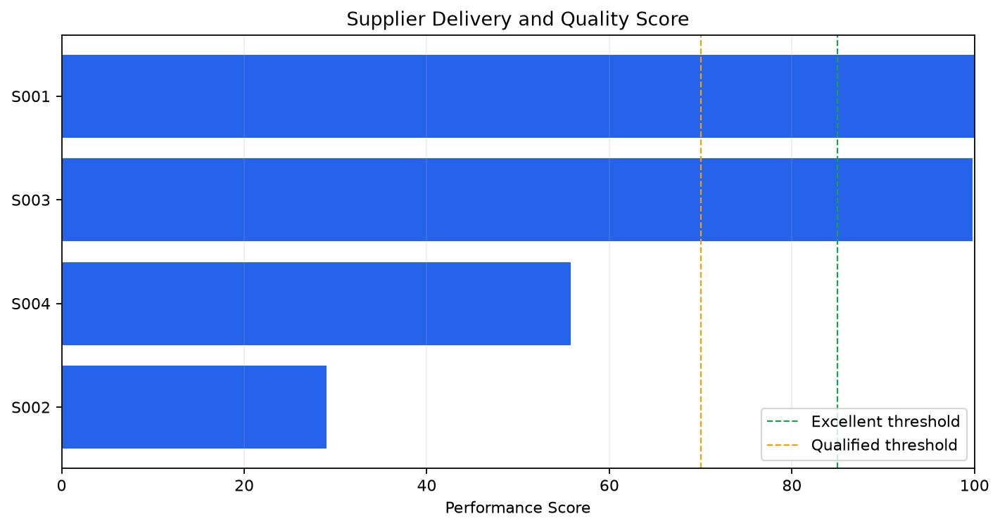
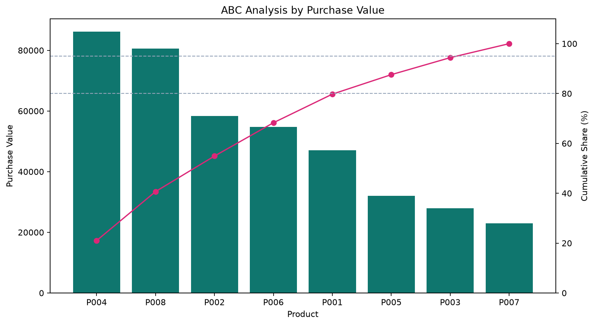

# 供应链运营数据分析｜Supply Chain Analytics

一个基于 Python 的轻量级供应链分析项目，以采购订单和库存快照为输入，完成数据质量检查、交付绩效分析、库存风险识别、ABC 分类、供应商评价和行动建议输出。

## 项目解决的问题

- 订单是否按承诺日期交付，延迟主要来自哪些供应商？
- 当前库存能否覆盖采购提前期，哪些 SKU 需要优先补货？
- 哪些物料占用了主要采购金额，应采用更严格的管理策略？
- 如何把交付、质量和库存数据转化为可执行的风险清单？

## 分析模块

### 1. 数据质量与清洗

- 校验必要字段、空文件和无效记录。
- 统一日期与数值类型。
- 按订单编号和产品编号去重。
- 过滤无法参与计算的异常数据。

### 2. 订单交付绩效

- 按时交付率（OTD）
- 平均交付周期
- 平均延迟天数
- 订单金额
- 来料不良率

### 3. 库存健康度

- 可用库存 = 现有库存 - 已分配库存 + 在途库存
- 库存覆盖天数（Days of Supply）
- 安全库存与补货点判断
- 目标库存和建议补货量
- 高、中、低三级库存风险

### 4. ABC 分类

按照累计采购金额将物料划分为 A、B、C 三类，辅助确定盘点频率、供应保障和管理优先级。

### 5. 供应商绩效

综合供应商的按时交付率和来料质量计算绩效得分，并输出“优秀、合格、待改善”分级。

### 6. 风险行动清单

将库存风险、ABC 分类和建议补货量合并，生成按优先级排序的行动建议，例如：

- 启动补货并确认供应商交期
- 评估调拨、消耗或暂停采购
- 保持监控

## 分析流程

```text
CSV 数据
   ↓
字段校验与清洗
   ↓
订单 / 库存 / 供应商指标计算
   ↓
ABC 分类与风险评分
   ↓
行动清单、CSV 明细、JSON 摘要和 PNG 图表
```

## 项目结构

```text
supply-chain-analysis/
├─ data/
│  ├─ orders.csv                 # 采购订单样例
│  └─ inventory.csv              # 库存快照样例
├─ src/
│  ├─ data_processing.py         # 数据读取、校验与清洗
│  ├─ analysis.py                # KPI、库存、ABC、供应商与行动建议
│  └─ visualization.py           # 图表生成
├─ tests/
│  └─ test_analysis.py           # 核心业务逻辑测试
├─ outputs/                      # 运行后生成的分析结果
├─ analysis.ipynb                # 可交互分析过程
├─ main.py                       # 命令行入口
└─ requirements.txt
```

## 快速运行

```bash
python -m venv .venv
```

Windows PowerShell：

```powershell
.\.venv\Scripts\Activate.ps1
pip install -r requirements.txt
python main.py
```

自定义数据与输出目录：

```powershell
python main.py --data-dir data --output-dir outputs
```

运行测试：

```powershell
pytest -q
```

## 示例运行结果

基于仓库内的虚构样例数据，程序会生成以下管理摘要：

| 指标 | 示例结果 |
|---|---:|
| 采购订单数 | 32 |
| 采购金额 | 409,780 |
| 按时交付率 | 59.38% |
| 平均交付周期 | 12.66 天 |
| 来料不良率 | 1.17% |
| 库存金额 | 192,385 |
| 高风险 SKU | 4 |
| 建议补货金额 | 129,329 |

这些结果用于演示从原始业务数据到 KPI、风险分层和行动清单的转换过程。

## 输出文件

| 文件 | 内容 |
|---|---|
| `summary.json` | 核心 KPI 摘要 |
| `order_detail.csv` | 订单交付周期、延迟与质量明细 |
| `inventory_health.csv` | 库存覆盖天数、风险等级与补货量 |
| `abc_analysis.csv` | 物料采购金额及 ABC 分类 |
| `supplier_performance.csv` | 供应商交付、质量和综合得分 |
| `action_list.csv` | 按优先级排序的风险行动清单 |
| `inventory_risk.png` | 库存覆盖天数与风险图 |
| `supplier_performance.png` | 供应商绩效得分图 |
| `abc_analysis.png` | ABC 采购金额与累计占比图 |

## 可视化示例







## 指标边界

- 示例数据为虚构数据，仅用于演示分析流程。
- 补货建议基于平均日需求、采购提前期和安全库存的简化模型。
- 供应商得分采用交付 70%、质量 30% 的示例权重，实际应用应结合企业管理规则调整。
- 项目输出用于辅助决策，不替代真实采购审批、供应商评审或生产计划流程。

## 可扩展方向

- 接入 ERP、WMS 或 SRM 的定时数据同步。
- 增加需求预测和滚动安全库存计算。
- 按产品、工厂、供应商和月份建立交互式看板。
- 引入服务水平、缺货成本和库存周转率等指标。
- 将风险清单接入邮件、飞书或工单系统。

## 技术栈

- Python
- Pandas / NumPy
- Matplotlib
- Pytest
